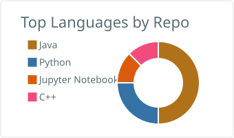

### Hi there 👋 I'm Sina

My name is Mohammadmahdi, but I go by Sina. I'm in the final year of my M.Sc. in Applied Computer Science (smart cities) at **Vrije Universiteit Brussel**, working at the intersection of **Privacy** and **Artificial Intelligence**.

- 🔭 I'm currently working on my thesis under Prof. Dr. An Braeken
- 📡 Previously: Research Intern at **UCD NetsLab** (O-RAN, xApps, Federated Unlearning) and Software Engineer Intern at **Dotin** (banking Switch in Java/Spring Boot)
- 📫 How to reach me: sinakhaji5@gmail.com

#### 🛠️ Tech
Java · Python · SQL · Spring Boot · Docker · Kubernetes · Hibernate

#### 📊 Most used languages

